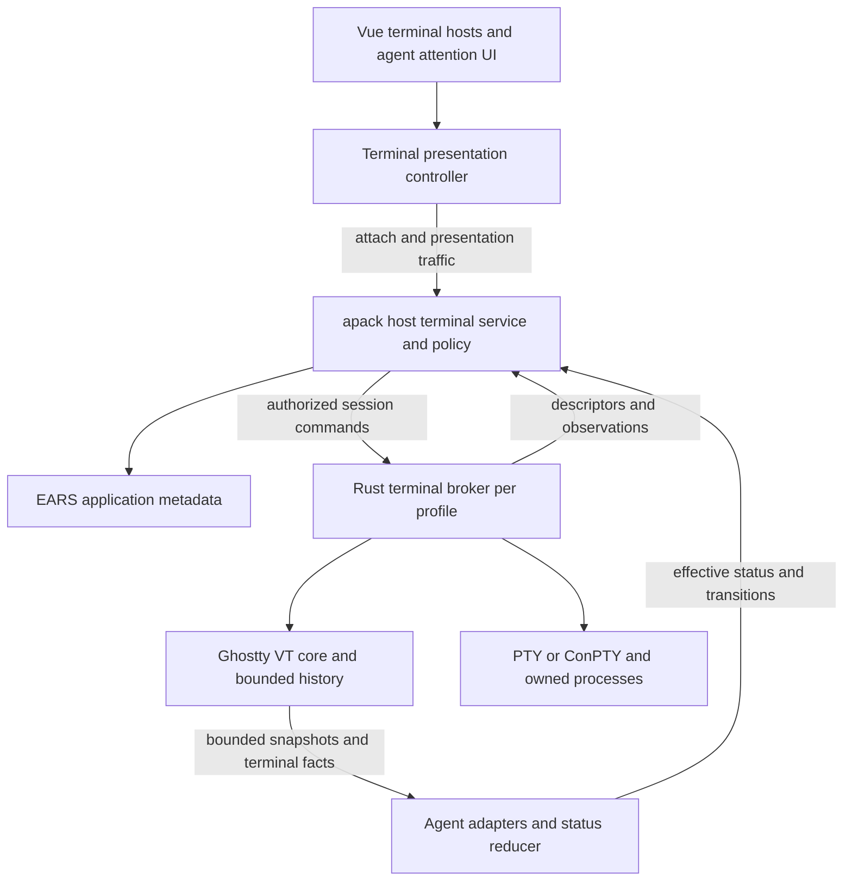

# Terminal runtime refactor target

Status: **active as design.** It authorizes nothing by itself; a goal does.

Its three halves are owned separately now:

- **Ownership** — the broker, the host service and the ownership tables — was delivered by
  [goal-terminal-ownership](../archive/goals/goal-terminal-ownership.md), which is complete. That goal kept
  xterm.js and took emulator replacement out of its scope, which is why the order this document originally
  named — migration first, then ownership — was inverted: both are answers to who owns a session, and
  sequencing them the other way moves ownership twice.
- **One terminal implementation** is [goal-one-vt-core](../goals/goal-one-vt-core.md), which this document's
  recommendation of a "headless Ghostty terminal core" asked for and which only became buyable when
  `libghostty-vt` 1.0 shipped a stable C ABI.
- **The agent-observation pipeline** — adapter capabilities, the status reducer, provenance, honest
  `unknown`, completion events — has no goal. This document remains its design authority and that work is
  unowned, not dropped.

## Recommendation

Build a host-owned terminal service with a small Rust broker that owns processes, a headless Ghostty
terminal core, bounded I/O and attach/recovery. Give it a first-class agent-observation pipeline that
can explain whether an interactive Claude/Codex session is working, waiting for input or back at its
prompt. Keep application policy, agent workflows, persistence relationships and Vue/XState
presentation in apack.

The main product gain from herdr is **observable agent sessions that remain meaningful when hidden**.
The architectural gain is **one process and terminal-state authority independent of its clients**.
Our existing terminal pool already keeps an emulator alive across view mounts; retaining that
capability is a prerequisite, not a new benefit attributed to herdr.

Adopt herdr's useful contracts, not its entire application. Its terminal abstraction still delegates
to a pane runtime with presentation dependencies, and its Claude/Codex status rules can mistake an
unrecognized screen for idle. We can establish cleaner boundaries and more honest status semantics.
The [code review and source evidence](../references/evidence/herdr-terminal-architecture-review.md)
records the inspected revision, execution traces, tests and limitations behind this proposal.

## Intended user experience

- A terminal continues working through canvas/panel moves, renderer reloads and API restarts. Closing
  a presentation detaches it; terminating a session is an explicit operation.
- A terminal list shows agent identity, working/attention/ready/unknown status, the reason for that
  status and an unseen-completion indicator. Hidden terminals still update their status.
- Clicking an attention item opens the correct session. Another window may observe it without
  resizing it or accidentally sending input. Taking control is explicit and visible.
- A crashed or restarted shell is a new process generation. Its old transcript is labeled history,
  and its old approval/completion evidence cannot affect the replacement.
- Search, bounded screen reads, wait-for-state and command metadata are available without mounting
  the terminal. Agents can use typed APIs rather than scrape UI components or sleep and guess.

Keeping work alive after **quitting apack** is a separate lifecycle policy. Recommend normal Quit
explicitly stops managed sessions by default, while an opt-in background mode leaves the broker
running and offers a visible Stop All action. Closing one terminal view or losing the API connection
must never be interpreted as Quit. Make the policy part of settings and acceptance rather than a
side effect of the process launcher.

## What to adopt and what to leave behind

| Area | Adopt | Improve or omit |
|---|---|---|
| Agent awareness | Process/session identity, parsed live-screen rules, OSC evidence, explain output, notifications and waits | Unknown on insufficient evidence; explicit turn outcome and readiness; no approval inferred from status |
| Ownership | Server-owned sessions and a runtime registry separate from pure state | Session core must not import tab/panel geometry, UI frameworks or agent-specific menus |
| Presentation | Hidden parsing without hidden rendering; independent observers; coherent recovery | Preserve our pooled views; do not port ratatui, terminal-inside-terminal encoding or a TUI shell |
| I/O | Serialized writes, control priority, coalesced resize and bounded frame demand | Bound every queue in bytes, reserve terminal-response capacity and expose overload |
| Persistence | Honest reattach versus fresh-process restore; separate optional history | No saved-PID killing, opaque ANSI truncation or redundant browser history authority |
| Agent integrations | Versioned data rules, hot-reload for diagnosis, capability-specific reports | Start with Claude/Codex; no remote rule marketplace or broad global config rewriting |
| Native dependencies | Upstream Ghostty VT core and a proven PTY substrate | Do not fork the whole herdr runtime or build another VT parser |
| Broader product | Stable session APIs usable by apack's CLI and packs | Leave cloud/SSH orchestration, updater, marketplace and duplicate workspace/worktree management out |

## Architecture and ownership

This diagram describes logical ownership. The bulk presentation stream should use a dedicated bounded
channel authorized by the host; it must not be republished as one generic bus event per PTY chunk.
Initially the host can broker a separate stream connection. If its proxy adds material copying or
backpressure cost, the host can issue an attachment capability for a direct shell-owned bridge.
Neither arrangement exposes an unrestricted broker socket to pack JavaScript.

| Owner | State and responsibilities | Must not own |
|---|---|---|
| Rust broker | Live process handles, terminal core, canonical dimensions, stream revisions, leases, bounded history, snapshots, shutdown | apack tabs, panel selection, thread workflow, provider credentials or EARS entity schemas |
| Host terminal service | Authorization, profile identity, pack ownership, session commands, app settings, reconciliation and metadata projection | A second mutable terminal screen or unbounded byte buffers |
| Agent observation service | Adapter capabilities, process/agent observations, status reducer, provenance and completion events | PTY ownership, UI DOM, automatic permission approval |
| Renderer presentation controller | One attachment per local host, focus, scroll anchor, selection, rendering and accessibility | Process creation/kill policy, authoritative history, global status inference |
| EARS and surface storage | EARS stores app relationships/bookmarks and selected durable metadata; surface storage stores local presentation preferences | A byte-stream mirror, live PID authority or per-frame dimensions |

Place native session ownership in the host platform, outside the Code pack. Code contributes the
terminal UI and uses the service. Other authorized packs, the CLI and agent workflows use that same
contract. Pack unload/reload detaches its presentation; session termination follows explicit ownership
policy. Coordinate access with the existing
[pack security isolation goal](../goals/goal-pack-security-isolation.md), without inventing a parallel
permission registry or claiming an unsandboxed pack is confined by API conventions alone.

## Domain model and lifecycle

Use separate identities with explicit lifetimes:

| Identity | Lifetime |
|---|---|
| `TerminalSessionId` | Logical session/bookmark independent of presentation |
| `ProcessEpoch` | One actual shell/command execution; changes on restart or revive |
| `BrokerEpoch` | One broker instance; prevents stale connection traffic surviving a restart |
| `AttachmentId` and generation | One client attachment/activation; prevents late callbacks changing a new view |
| Control lease and revision | Current authority to send user input and request geometry |
| `AgentInstanceId` | Agent process/session within a process epoch; a shell can launch several agents over its life |
| Provider session and turn IDs | Provider identity where available; resuming a conversation does not revive the old process |

PIDs are diagnostics. Native handles and platform process identity govern signals and cleanup. A
persisted record never authorizes killing the process currently occupying its old PID.

The broker owns a small explicit state machine: allocating, starting, running, stopping, exited or
failed. It installs output/exit handlers before a child can emit unobserved output, rolls back partial
creation and applies session/resource limits to both create and restore. Exited content remains
readable until retention policy removes it. Restart changes the process epoch and keeps the logical
session's presentation identity, so tab position/group/pin do not depend on close-and-recreate races.

The host/XState machine owns service connectivity and application requests. Pure lifecycle reducers
choose effects; platform implementations perform spawn/resize/signal/wait. Do not mirror every broker
internal state into a second app state machine or put actor dispatch on the per-byte parsing path.

### Reconnect and recovery guarantees

| Event | Required behavior |
|---|---|
| View unmount or move | Dispose attachment listeners; session/core continue |
| Renderer crash | Broker continues; replacement renderer gets a coherent current snapshot |
| API restart or pack reload | Broker continues; host reconciles live descriptors, reauthorizes attachments and re-establishes status observations |
| Normal application Quit | Apply the selected stop/background policy and await bounded cleanup |
| Broker crash | Mark sessions disconnected/lost; never claim the old process continued; reconcile native containment before offering explicit revive |
| Machine restart | Restore metadata/history as history; launch only under restore policy with a new process epoch |
| Broker/core upgrade | Reconnect only when the exact supported protocol/core contract matches; otherwise show a maintenance action to stop/restart sessions |

Do not require Unix descriptor transfer for the first target. A broker independent of API/UI releases
already avoids many process interruptions. Session preservation through a broker crash, reboot or an
incompatible native-core upgrade is not promised by a snapshot file.

## Agent observation and attention

This is the first product capability to deliver after the prerequisites, rather than an optional badge
added after a native rewrite. It must work without a visible terminal and without global hooks for
ordinary manually launched Claude/Codex sessions.

### Keep identity, activity, readiness and outcome distinct

Herdr's four-state model and unseen-idle `done` presentation are useful inspiration. Our model should
keep independently meaningful facts instead of turning them into a larger ambiguous status enum:

| Dimension | Proposed values and meaning |
|---|---|
| Process | Starting, alive, stopping, exited, lost |
| Agent activity | Unknown, working, awaiting input, idle |
| Readiness | Unknown, prompt ready, not interactive, suspended/background |
| Attention reason | Permission, question, authentication, startup/trust dialog, failure, or unknown |
| Last turn outcome | Completed, interrupted, failed, or unknown; also whether reported or inferred |
| User awareness | Last acknowledged completion/attention event per user, with presentation state per window |

Store evidence with source kind, adapter/rule version, process/agent epoch, source sequence, observed
terminal revision and a reason code. Prefer a categorical provenance such as `reported` or `inferred`
over an invented numeric confidence score. An explicit provider outcome can be stronger than a visual
inference, but only for the lifecycle events that provider actually reports.

An idle prompt is not proof that the preceding work succeeded. A shell exit is not successful agent
completion. A permission prompt is not permission to approve it. A provider conversation ID does not
establish any of those facts by itself.

### Observation pipeline

1. **Identify the agent instance.** Prefer an app-managed launch registration or scoped provider session
   report. Otherwise inspect the live foreground process/job using platform mechanisms. Track process
   start identity and job control; invalidate screen evidence when a replacement takes over. Support
   explicit launch hints for wrappers without treating an inherited name as authoritative.
2. **Collect bounded semantic evidence.** Read the canonical active screen/live tail, parsed title and
   progress, command markers and process facts. Detect against live state independent of user scrolling.
   Incremental VT parsing handles sequences split anywhere across chunks; do not regex raw PTY chunks.
3. **Classify evidence through an adapter.** Start with data-only Claude and Codex manifests with explicit
   regions, priorities, AND/OR/NOT gates and transcript-view exclusions. Bound regex/input complexity,
   compile rules once and associate every result with the adapter and observed revision.
4. **Reduce evidence in one place.** A pure reducer uses source capabilities, epochs and freshness to
   produce effective activity/readiness/outcome. Display metadata cannot take lifecycle authority.
   Duplicate/stale reports do not transition state. Loss of a signal becomes unknown or a retained
   explicitly stale observation, never a fabricated successful completion.
5. **Publish transitions and attention.** Emit a stable event ID once per meaningful transition, retain
   completion history independently of current state, and let clients acknowledge what they saw. A
   fresh working turn must not erase an unseen previous completion.

Use revision-triggered scheduling for screen work plus bounded process/liveness checks and explicit
expiry deadlines. A status timer must not repeatedly format the entire scrollback or inspect every
process tree. Hidden terminals parse and classify; they do not draw frames. Pin a coherent observation
revision before extraction and discard results whose owner changed while analysis ran.

### Evidence precedence

| Situation | Reducer behavior |
|---|---|
| Structured runner/provider emits an exact current turn event | Use it for the event dimension the adapter supports; retain explicit failure/interruption |
| Reporter sends only session identity | Associate the session; keep screen/process classification for activity |
| Known CLI shows a recognized live attention dialog | Mark inferred awaiting-input with rule/reason; do not answer it automatically |
| Known CLI shows positive working or ready evidence | Show inferred working or idle/readiness as supported by that rule |
| Known CLI has no matching rule or title is missing/static | Unknown; keep the last observation with age if useful, without announcing completion |
| Transcript viewer or agent suspended behind a shell | Do not classify historical/other-job text as live agent state; annotate observation limits |
| Provider reports conflict with fresh strong screen evidence | Apply the adapter's documented dimension-specific policy; surface a conflict instead of silently overwriting strong evidence |
| Process/agent instance changes | Invalidate old titles, reports, pending attention and source sequence ownership |

Herdr's `default_known_agent_idle_fallback` is the clearest behavior to reject. Its stabilization cap
only delays that inference. Our default should favor an honest unknown badge over a false finished
notification or automated input into an unrecognized approval dialog.

### Claude and Codex adapters

For manually launched interactive CLIs, borrow the shape of herdr's manifests: process-gated live
regions, spinner/title and footer evidence, explicit approval forms, transcript exclusions, queued-input
handling and startup readiness separate from turn completion. Treat each CLI version range as a
tested compatibility claim; static titles, reduced-motion output, narrow windows and optional OSC
settings are required variants.

Add optional structured integration only when it demonstrably improves coverage. Herdr currently
uses session-only hooks for both Claude and Codex, and its history includes removing lifecycle hooks.
Do not assume a `Stop` callback proves final completion or a pre-permission event covers cancellation,
denial, interruption and every return-to-work transition. Validate the full lifecycle before granting
authority. If a source cannot report a resolution, bound its authority and reconcile with fresh
evidence; merely expiring a timer must not mark the turn completed.

Where apack already launches an agent through a structured runner, use its exact session/turn/tool
events. Future provider-protocol adapters may be stronger still, but switching a manually launched
interactive CLI to an API-driven client changes the product and is separate work. Current
[Claude hook documentation](https://code.claude.com/docs/en/hooks) and
[Codex app-server source](https://github.com/openai/codex/tree/main/codex-rs/app-server) provide candidate
contracts to test, not proof that a single hook mapping is complete for every installed version.

Integration setup must be explicit, scoped and reversible. Prefer per-launch/provider-supported
configuration; do not silently rewrite users' global agent settings. Use a tiny bundled reporter over
local IPC rather than spawning Python and parsing arbitrary transcripts for every state change.
Reporter capabilities are session-scoped, carry a reporter epoch/sequence, and grant no app API or
other-session control. Terminal child code can still spoof its own status; observation is not a
security authority.

### APIs and user interface

Provide typed session `read`, `observe`, `explain` and `wait` operations. Reads name their source
(active screen, recent output, command output) and return revision, truncation and process epoch.
Wait subscribes from a revision with cancellation/deadline and explicit history-gap outcomes, rather
than polling the renderer. A UI can show “awaiting permission, inferred by Claude rule X” with a
bounded explanation. Raw screen snippets remain on-demand diagnostics because they can contain secrets.

Keep three actions separate: raw key input, bracketed paste and submit-text. Submit-text is an ordered
request with a known agent/process epoch and an explicit readiness requirement. Report admission,
bytes written and observed execution separately. If connection loss leaves a write outcome ambiguous,
return that fact; never blindly resend a possibly executed command. “Idle” alone must not cause an
orchestrator to type into a session. Screen heuristics cannot make automated approval safe.

## Native broker and dependency strategy

### Prefer a small owned Rust package over a herdr fork

Recommend an independently buildable crate/binary, provisionally `apack-terminal`, in a separate
repository if that matches elmdb maintenance. Its reusable core accepts executable/argv, environment,
cwd, dimensions, resource policy and opaque IDs. It has no dependency on EARS schemas, Vue, XState,
provider SDKs or apack's workspace graph. Keep apack-specific adapters in this monorepo.

Start from upstream `portable-pty` as a candidate substrate and libghostty-vt's public C ABI for
terminal semantics. Validate process containment, cancellation, ConPTY resize/exit behavior and
packaging before selecting them. Herdr's patched substrate is evidence of integration cost, not a
reason to assume upstream handles every lifecycle requirement. A standalone broker is preferred to
loading a native addon into the API: an addon alone cannot preserve processes through API failure.

Rust pays for native handle ownership, efficient bounded buffers, headless parsing and process
isolation. It does not guarantee a safe FFI, predictable shutdown or correct queues. Put unsafe
Ghostty bindings in one audited module; serialize terminal mutation, keep callback ownership explicit
and prohibit callbacks from reentering the terminal or blocking on app RPC.

Build one broker per resolved apack profile with an exclusive runtime lock and an authenticated local
endpoint. Electron main/host bootstrap discovers or starts the exact supported build and reconciles
it; generic API child cleanup must not kill it accidentally. Bind private Unix sockets or named pipes
with appropriate ownership/ACL checks. Bootstrap capabilities must not be command-line arguments,
logs or broadly inherited environment variables. Main-process loss and reconnect policy must be
tested explicitly; an orphan broker must remain discoverable and stoppable.

### ghostty-web remains useful but does not become a second authority

The earlier migration improves our browser emulator. It does not provide headless server state or
an attach protocol by itself. The long-term target needs a proven native/browser state boundary.

Preferred path: pin the same Ghostty core revision and capability configuration for native authority
and a browser/WASM replica. Transfer a full snapshot at revision Q, then apply the ordered terminal
mutations after Q. Browser replicas generate no PTY responses, clipboard writes or shell-integration
events; the native authority owns those effects. The browser keeps local scroll, selection and
presentation. Multiple parsing copies are acceptable as bounded replicas; multiple independent
authorities are not.

This is a **prototype requirement**, not a claim about today's ghostty-web API. Current upstream
[VT headers](https://github.com/ghostty-org/ghostty/blob/main/include/ghostty/vt.h) expose snapshots,
render state and input facilities. The
[snapshot contract](https://github.com/ghostty-org/ghostty/blob/main/include/ghostty/vt/snapshot.h)
includes unfinished parser input and incremental restore, but explicitly lacks a binary-compatibility
guarantee for snapshot format 1. The
[WASM interface](https://github.com/ghostty-org/ghostty/blob/main/include/ghostty/vt/wasm.h) is a low-level
binding surface, not a browser UI. Do not assume a stable ABI implies a stable snapshot format or that
the separate [ghostty-web package](https://github.com/coder/ghostty-web) exposes these facilities.

The first spike must demonstrate full native-to-WASM restore, ordered resize/reset/output,
effect suppression and identical semantic observations on a shared corpus. Prefer upstream
ghostty-web integration changes; maintain a narrow fork only if the needed public interface is small
and sustainable. Record upstream revision, patches, removal conditions and release verification as
elmdb/herdr do for their native dependencies.

If that route fails, a renderer consuming cell/history projections from the native authority is the
coherent alternative. It is substantially more work: font shaping, IME, accessibility, selection,
search, hyperlinks and graphics all need ownership. Prototype it before approving that scope. Stop
the native cutover if neither presentation route meets parity. Do not ship a native parser and an
unrelated browser emulator with divergent modes, replies and recovery semantics.

### Platform mechanisms

Use common lifecycle contracts over OS-specific implementations. On Unix, retain the actual child,
PTY and process/session identity, signal only owned live processes and reap them. Process groups are
useful but do not promise containment of deliberately daemonized descendants; document the boundary.
On Windows, use ConPTY with independently serviced blocking channels and owned process/job handles;
validate job assignment before the child can escape where supported. Reject unsupported containment
explicitly rather than calling kill and assuming every descendant stopped. These choices follow
[Microsoft's ConPTY guidance](https://learn.microsoft.com/en-us/windows/console/creating-a-pseudoconsole-session)
and [Job Object semantics](https://learn.microsoft.com/en-us/windows/win32/procthread/job-objects).

Explicit asynchronous shutdown stops admission, drains or cancels accepted requests under a bounded
policy, terminates owned processes, closes I/O, waits/reaps and publishes one final outcome. Keep
emergency destructor cleanup minimal. Do not block the central service loop while every terminal
performs a sequential grace-period sleep.

## Protocol and resource contracts

Commands carry request ID, broker/process epochs, authorized attachment identity and control-lease
revision where applicable. One schema generates Rust/TypeScript codecs; validate size and semantic
constraints at the boundary. Use framed binary payloads for byte traffic, with bounded structured
control messages. App-level correlation already exists and must remain intact.

Create/terminate/rename may use bounded request deduplication within a declared epoch. Input is an
effectful ordered stream: distinguish accepted from written and do not promise exactly-once behavior
across a broker crash. Unknown outcomes remain unknown. Reject version/core mismatches explicitly;
the repository has no need to retain a perpetual legacy codec for hypothetical third-party clients.

### Snapshot and live stream boundary

Serialize output, accepted geometry changes and terminal resets/clears into one mutation order.
Raw output bytes alone cannot reconstruct reflow across resize. Capture a coherent snapshot at Q,
retain mutations after Q within a byte budget and attach the client to that ordered suffix. Use
checksums/revisions to detect corruption and duplicate or missing delivery. Reattach or request a
new snapshot when the suffix is no longer retained; never silently drop arbitrary VT bytes.

Start with bounded complete restore and a visible loading state. Progressive history is an optional
optimization after proving that old pages can arrive while new output/resizes apply correctly. A
snapshot with unfinished UTF-8/OSC/CSI must recover identically to uninterrupted parsing. Terminal
effects fire once at the authority during live input, never during client replay or historical import.

### Backpressure and fairness

| Traffic | Required behavior |
|---|---|
| PTY output into canonical parser | Bounded byte accounting and real upstream read backpressure; never drop bytes before parsing |
| User input and submit requests | Bounded item and byte admission; explicit busy/rejected outcome; no silent keystroke loss |
| Terminal-generated responses | Reserved bounded capacity and priority so output pressure cannot deadlock a query-response exchange |
| Resize | Latest valid desired size, deduplicated/coalesced before application; ordered with terminal mutations |
| Presentation frames | Bounded replaceable work; slow observers resnapshot independently |
| Browser mutation replica | Bounded credit through actual parser completion; a stalled replica is reset from authority |
| Metadata/events | Bounded retained revisions with explicit gap recovery; no endless control queue |
| Search/detection/history export | Cancellable, bounded work outside the critical write path; narrow reads and revision caches |

Replacing an intermediate frame is safe; dropping arbitrary output bytes is not. A slow observer must
not stop the shell or another client. A slow canonical parser can legitimately backpressure its
producer. Shutdown/interrupt and protocol replies need service even during sustained output. Treat
every internal queue and socket buffer as part of the budget, including Windows writer threads.
The distinction between socket acceptance and parser completion is also documented in
[xterm's flow-control guide](https://xtermjs.org/docs/guides/flowcontrol/).

Allocate per-session and aggregate profile limits for output/history, outstanding input, clients,
snapshots and diagnostic work. Measure visible and hidden work separately across many terminals and
observers. Metrics report bytes/queue depth/lag and state-transition counts, with payloads excluded.

## Presentation and control

Allow several read-only observers and one explicit control lease per terminal. The controller alone
owns input and geometry. Moving the terminal between panel and canvas transfers the local attachment;
another window can observe at canonical dimensions with clipping/letterboxing until it takes control.
Do not resize the PTY to each observer's font or container. On controller detach, release the lease
and keep the last valid grid until another controller claims it; avoid a synthetic hidden size.

Lease revision and attachment generation fence late resize/input and stale detach callbacks. Browser
focus remains local; only effective controller focus changes produce terminal focus-reporting input.
Do not steal focus when output arrives or an observer reconnects. Independent observers own scroll
and selection, not a shared mutable viewport in the broker.

Send semantic key, mouse, focus and paste intents to the authority for encoding against canonical
terminal modes. The browser supplies composed text and geometry provenance; it must not independently
decide application-cursor, Kitty keyboard or bracketed-paste mode from a lagging replica. Reserve raw
byte input for explicitly authorized low-level callers. Keep platform shortcut dispatch and IME text
composition in the renderer, and test their boundary with the native encoder.

The presentation controller exposes attach/detach, fit intent, focus, selection, paste and viewport
operations. Vue components do not subscribe to PTY output or wire emulator input. Keep one emulator
per local presentation where needed and virtualize hidden presentation resources; the server retains
the authoritative state. Keyboard dispatch must arbitrate app shortcuts against terminal ownership,
with platform-specific copy/paste and IME behavior covered in Electron.

## History and persistence

Keep canonical in-memory terminal state and bounded history in the broker. Persist optional
checkpoints/history off the hot path, under the profile, with explicit retention and clear semantics.
The broker owns those files and its runtime recovery manifest; EARS owns app references and bookmarks.
Project live metadata into the app only when it changes. Do not open the application database from
the broker or duplicate its live lifecycle truth in EARS rows.

Start with single-writer atomic checkpoint replacement and bounded optional transcript segments;
there is no need for a new general database. If later query/retention requirements justify elmdb's
Rust storage, use an isolated broker-owned database through its supported Rust API after verifying
that boundary. Do not couple terminal-core types to the application's entity schema or add a second
database engine without a requirement it solves.

Checkpoint content, process epoch, core build and mutation boundary must agree. Publish immutable
segments before atomically committing the manifest that references them; validate length/checksum
and resource limits on read, and never infer executable launch authority from transcript data. Cold
restore validates shell/cwd/argv again, creates a new process epoch and displays a historical seam.
Agent resume invokes a provider-supported resume operation; it cannot resume arbitrary OS execution.
Clear-history invalidates persisted checkpoints and retained history as one generation change, so
reconnect cannot resurrect cleared text.

Shell integration is a launch-time adapter capability. Prefer supported shell initialization scripts
and parsed OSC command markers for cwd, prompt, command start/end and exit status. Treat reported
paths/titles as untrusted metadata. Keep launch cwd separate from observed cwd; remote OSC paths must
not silently become local spawn paths. Distinguish a running command from an agent turn. Follow the
bounded capabilities and remote limitations in
[VS Code's shell integration design](https://code.visualstudio.com/docs/terminal/shell-integration).

## Security and operational ownership

Terminal output is untrusted input to the emulator and application. Enforce existing URL policy,
bound OSC payloads, and route clipboard/image/file effects through explicit host policy. No replayed
output triggers clipboard writes, links, process launch, hooks or app navigation. Keep environment
construction allow-listed with explicit user/provider additions; never hand app tokens to every shell.

A session status reporter gets a narrow capability, not general terminal control. Observation/read,
input/control, spawn and terminate are separate service permissions. Match the pack isolation goal's
actual enforcement boundary; a broker process is crash isolation, not automatically a sandbox for
host-privileged code. Logs contain IDs, sizes, revisions and reason codes, not keystrokes, prompts,
raw OSC or transcripts. On-demand debug capture is bounded and sensitive by design.

Ship prebuilt signed/notarized native binaries for supported platforms, pinned with the JS client and
core/WASM build. Install and update the broker through apack's existing release paths, not a second
updater. A contributor can build it independently; end users should not need Rust/Zig toolchains.
Native release verification covers architecture, OS runtime support, licenses, offline launch and
protocol/build mismatch reporting. Crashes, unsupported startup and persisted-history failures must
surface as actionable UI outcomes.

## Why this target and the alternatives

| Option | Benefit | Limitation | Recommendation |
|---|---|---|---|
| TypeScript host with node-pty and browser Ghostty | Lowest change cost; enough for many review fixes | Headless state/detection still need a reliable owner; API lifetime remains process lifetime unless another host is introduced | Not taken: the Rust broker below was built instead, and node-pty is gone from the tree |
| Separate Node PTY host | Can preserve sessions across API restarts without Rust | Still needs headless VT, native platform handling and bounded protocols | Valid cheaper alternative if it meets the same contracts; compare during the spike |
| Rust native addon inside API | Efficient native access | Shares API crash/lifetime boundary; cannot supply the main persistence guarantee | Useful for bindings, insufficient as final runtime ownership |
| Rust broker plus upstream Ghostty core | Headless state, independent lifetime and native handle ownership | Native release/FFI costs; browser state handoff must be proven | Preferred long-term target |
| Adopt/fork herdr as the runtime | Many features already implemented | TUI/client coupling, identity/status assumptions, remote product and broad maintenance surface | Do not adopt wholesale; extract ideas or small audited components |
| tmux/WezTerm as mandatory external runtime | Mature attach/mux behavior | Extra user dependency, platform/protocol/UI fit and duplicated product model | Architectural references, not the default integration |
| Custom VT parser or native desktop renderer | Maximum control | Large correctness, accessibility and maintenance burden | Reuse Ghostty semantics; custom presentation only if a spike earns it |

The Rust recommendation follows the required contracts, not a claim that Rust alone is faster or
cleaner. If a separate Node host with upstream bindings meets the same reliability, memory and
platform tests at lower maintenance cost, keep the process/service design and choose that mechanism.

## Delivery checkpoints

The following checkpoints start only after the prerequisite migration and issue work are accepted.
Their outputs must be concrete enough to decide whether to continue without committing to a rewrite
on the strength of a demo.

| Checkpoint | Deliverable and dependencies | Closing checks |
|---|---|---|
| 0. Reconcile and characterize | Map delivered pool/service contracts and review findings to required behavior; record baseline scenarios | Request routing, replay suppression, process restore, tab/panel lifecycle, input and multi-window behavior have named acceptance cases; no fixed requirement is reopened without changed evidence |
| 1. Prove agent observations | Pure reducer, bounded Claude/Codex adapters and explain API over a headless terminal experiment | Real CLI scenario matrix, no-match unknown, scroll independence, stale-session rejection, explicit completion/attention provenance; no global settings changed as part of research |
| 2. Prove native/browser state | Disposable broker/core/WASM experiment; exact dependency/build selection | Snapshot continuation, effects-once, resize/reflow order, reconnect and semantic parity; document whether ghostty-web can support the boundary without a broad fork |
| 3. Establish the host service | Independently packaged broker and typed authorized host API; depends on 1 and 2 | Profile exclusivity, partial-spawn rollback, epoch/lease fencing, bounded queues, platform process containment and offline packaged loading |
| 4. Integrate presentation and attention | One controller plus observers, both existing hosts, agent list/notifications/waits | Renderer/API loss does not kill sessions; slow observer is isolated; focus/IME/accessibility and independent scrolling pass; completion acknowledgments are coherent across windows |
| 5. Persistence and native cutover | Bounded broker history, policy-driven restore/quit and owned dependency release | Clear survives reconnect; corrupt checkpoint cannot launch code; cold revive is visibly new; stop-all and shutdown leave no supported owned-process leaks; old production service/history path removed |

Observation and native/browser spikes can be evaluated separately, but production agent status must
ultimately observe canonical session state. Do not make the renderer a temporary permanent source
for hidden-session truth. No permanent dual runtime or compatibility layer is required for cutover.

### Agent observation acceptance matrix

Use pinned real Claude/Codex versions and explicit terminal settings. Capture minimal redacted
observations and expected transitions, not an uncontrolled archive of user transcripts.

- Startup idle versus working with a visible composer; normal turn; queued follow-up; slow tool or
  network pause with no output; background task still active.
- Permission/question/authentication/trust dialogs, including allow, deny, Escape and Ctrl+C. A
  completion-like title or old prompt must not override an unresolved current dialog.
- Successful completion, cancellation, failure, reconnect failure, process crash and shell return.
  Unknown stays unknown where the CLI exposes insufficient evidence.
- Static titles, OSC disabled, reduced motion, narrow/short geometry, wrapping, transcript viewer,
  user scrolled into history, alternate screen, and concurrent terminals running different versions.
- Agent clear/resume/fork/compact and another same-kind process replacing it; subagent reports,
  duplicate/reordered reports, dropped lifecycle callbacks, job suspension and foreground return.
- A transcript containing approval/idle phrases, adversarial printed text and unrecognized new UI.
  None can grant permission or automatically satisfy submit readiness.

Test reducer/manifest mechanics with synthetic inputs and recorded-clock decisions. Separately test
the shipped Claude/Codex rules against a small reviewed corpus and live workflows; generic engine
tests alone cannot prove agent compatibility. Report false finished/ready/attention classifications,
unknown coverage and detection latency for each supported version/settings combination. A single
aggregate accuracy percentage hides the mistakes that matter. The release gate requires no false
completion/readiness claims in the required adversarial cases; broader live accuracy remains measured
evidence rather than a universal guarantee.

### Runtime acceptance matrix

- Split representative streams at every byte boundary, including UTF-8, CSI/OSC/DCS/APC, query/reply,
  alternate screen and snapshots with unfinished parser input. Compare uninterrupted and recovered
  semantic state, input modes and emitted effects.
- Race close/restart/resize/attach and control transfer; reject stale generations deterministically.
  Reconnect mid-output without duplicate bytes, old input, duplicated replies or truncated sequences.
- Fill every queue and force partial writes; interrupt/terminate must remain serviceable. Isolate
  stalled clients and bound both per-session and total profile memory.
- Measure 1 and many populated sessions, hidden versus visible, multiple observers, large history and
  sustained output. Report CPU, memory, input responsiveness, detection work, resnapshot size and
  disk writes. Benchmark release builds on the same environment; choose performance limits from the
  baseline before cutover, with deterministic allocation/work bounds where possible.
- Exercise real macOS/Linux/Windows process trees, shell selection/cwd/argv, ConPTY startup/exit,
  renderer/API/main loss, and broker shutdown under blocked I/O. Do not infer Windows behavior from
  Unix-gated tests.
- Verify app packaging, native/WASM build agreement, permissions, offline assets, recovery and
  accessible interaction in an installed Electron build.

During implementation use the repository's focused `npm run spec` loop and the applicable final chain
gate from `CLAUDE.md`. Native crate tests and packaged Electron scenarios supplement that gate.
Follow the [native execution boundaries](../../CLAUDE.md) and
[Windows workflow](../references/guides/windows-development-vm.md); this design review itself requires
no native builds or implementation suites.

## Decisions to settle before production implementation

1. Does the exact upstream/native/WASM combination support coherent snapshot transfer and effect
   suppression through a small browser integration, or does presentation require materially more work?
2. Which Claude/Codex versions/settings can we claim to observe, and which dimensions remain inferred
   or unknown? What exact structured sources improve those claims without hiding missing transitions?
3. Does a Rust broker beat a separate Node host on the required platform/recovery/maintenance
   contracts? Select the mechanism after the experiments, retaining the same ownership model.
4. Is optional background-after-Quit in the first delivery, or does the first version retain explicit
   stop-on-Quit? Session survival through view/API loss is required either way.

The recommended next action is checkpoint 0 followed by the agent-observation and native/browser
proofs. The success criterion is reliable, explainable sessions with fewer competing owners; porting
herdr's feature count or changing implementation language is not an acceptance criterion.
