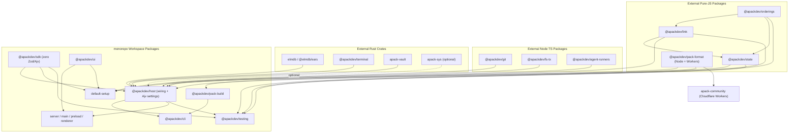

# Platform Modernization Roadmap

*Updated 2026-11-24 · Continuous numbering (`#1`–`#26`), ordered by execution phase.*  
**Size:** `S` (hours) · `M` (days) · `L` (1–2+ weeks)

> [!IMPORTANT]
> **Cutover guard:** Until Phase 3 (`@apackdev/state` + `@apackdev/link` cutover) lands, avoid broad mechanical edits (lint autofixes, annotation passes, `afterEach` scrubs) across the ~132 XState specs and ~27,500 lines of machine definitions so every edit doesn't become a merge conflict on the cutover branch.

---

## Phase 1 — Land & Foundation (now, zero conflict with cutover)

| # | Work Item | Size | Scope |
|---|---|---|---|
| 1 | ~~**Merge PR #632 & PR #633**~~ *(Done — merged on `master`)* — Node 24 / `erasableSyntaxOnly` follow-ups (`#632`) and [singleton-free-test-harness.md](singleton-free-test-harness.md) (`#633`). | S | `monorepo` |
| 2 | **Run full gate on `master`** — `npm run chain` / CI (Linux `test:native`, full `test:integration`, `test:e2e`) to baseline post-#628/#632. | S | `monorepo` |
| 3 | **Split `@apackdev/sdk` along the runtime vs. format/compiler seam** (workspace packages in `monorepo` first; builds on merged prep PRs `#634` — zero-Zod `@apackdev/sdk/runtime` + `main` and end-to-end Standard Schema v1 pinning — and `#635` — zero-Zod `#generated/services.ts` + `apack pack init`): • **`@apackdev/sdk`**: zero Zod, zero Ajv, zero compilers — plain TS interfaces + runtime APIs + tiny zero-dep authoring helpers (`entry`, `on`, `ActionMeta`, `PromptMeta`, `FlowDSL`, pure `_settingsJsonProblems`); drops required `peerDependencies.zod` (still auto-installed by npm on fresh packs today) and clears the remaining 6 `etc/*.api.md` transitive `import { z } from 'zod'` lines. • **`@apackdev/pack-format`** *(Workers-safe, pure JS — no `node:fs`, no `ajv`)*: Zod manifest & snapshot schemas, `PACK_LAYOUT`, `semver` host compatibility, `apack.schema.json`. • **`@apackdev/pack-build`** *(or inside `@apackdev/cli`)*: codegen (`generate-entries`), content compilers, settings types, `json-schema-to-typescript`, `mdast-*`, `yaml`, `esbuild`, `typescript`. • Move `settings-validation.ts` (`ajv`) out of `ManifestSchema.superRefine` into `@apackdev/host` (inlined into `@apackdev/cli`) — `#634`'s server CPU profile showed Ajv settings compilation takes ~120–160 ms (~13–17% of active backend startup CPU, 2–3× more than Zod itself), so separating/deferring it is a direct startup win — and remove static host re-validation from renderer's [pack-catalog.ts](../../packages/apack-host/src/fe/pack-catalog.ts). Splitting Zod out of `@apackdev/sdk` eliminates ~8.0s of aggregate cold `tsc`/`vue-tsc` time across 18 programs and 22.9% of instantiated types (measured 2026-11-24, PR `#634`); removing renderer re-validation drops the remaining 94.3 KiB minified / 26.7 KiB gzip Zod from the renderer bundle (Vite prod build, 2026-11-24). | M | `monorepo` |
| 4 | **Extract root `tsconfig.base.json` (+ `node`/`dom` presets) & drop `baseUrl`** in [packages/main/tsconfig.json](../../packages/main/tsconfig.json) and [packages/preload/tsconfig.json](../../packages/preload/tsconfig.json) — eliminates per-package tsconfig drift and preps for TypeScript 7. | S | `monorepo` |
| 5 | *(Optional pre-cutover win)* **Enable Vitest 4 `test.projects` + `isolate: false`** on already-pure, non-XState, non-`bindHost` suites (`apack-cli` unit, `apack-sdk/tests/{utils,build}`, pure `internal-repo-checks` / `apack-host`), verified with `--shuffle`. | S | `monorepo` |

---

## Phase 2 — Cutover Readiness (2–4 days of de-risking before opening cutover branch)

| # | Work Item | Size | Scope |
|---|---|---|---|
| 6 | **Finalize & pin external kernels:** merge `apack-state#30` (port-only kernel over `@apackdev/link`), `apack-state`'s `ci-kernel-boundaries` fix + `@apackdev/link` pin (`apack-link` `#25`/`#26`/`#27` and `apack-state` `#31` on `@apackdev/orderings` are already merged on `master`), the `apack-state` **deterministic clock & deadline PR** (`system({ clock })`, once-per-step `time`, `until(due)` — replacing `later`, see [Deterministic Clock & Deadline Architecture](#deterministic-clock--deadline-architecture-6)), and the two remaining brain-blocking kernel items (**runtime-built handlers** for dynamic flow triggers and **bare writes at the top of `run`**); pin the `elmdb` release with `caughtUp({ soon: true })`, add `apack-state`, `apack-link`, and `apack-orderings` to [external-packages.mjs](../../scripts/lib/external-packages.mjs), and add `@apackdev/state` and `@apackdev/link` to `SHARED_INSTANCE_PACKAGES` (only packages shared between host and packs; keep test-only `@apackdev/orderings` out of the production bridge). | S–M | 4 repos |
| 7 | **Spike `utilityProcess` + `MessageChannelMain` (1 day) & lock `packages/main` ↔ `packages/server` window-owner lifecycle** — if the spike passes, land `utilityProcess` as a standalone pre-cutover PR and hand each window a `MessageChannelMain` at cutover (authority by possession — no HMAC, watermark, `window:gone`, or loopback window port); if it fails, fall back to the reconciled HMAC design (no `apiToken` in windows, preload-owned single link, spawn-env watermark, IPC disconnect invariant). Both paths keep `link.onEnd`-bound subscriptions, `@apackdev/orderings` every-ordering verification, and a dedicated local-tool path covering `apack pack drive --channel beta`. See [Window-Owner Lifecycle & Deferred Transport Architecture](#window-owner-lifecycle--deferred-transport-architecture-7). | S–M | `monorepo` |
| 8 | **Run a throwaway 1-feature spike in the test harness** (not in the live app, since XState and `apack-state` never share a bus) against the released tarballs porting the hardest real slice (**commit surface**, plus validating a live brain flow touching `runHistory`) to verify the non-EARS transaction boundary and benchmark TS 5.9 compile time extrapolated to 49 machines. | M | `monorepo` |
| 9 | **Write the feature-by-feature cutover order/size table** and lock the **singleton-free `using`-disposable test harness** contract (`@apackdev/testing` + `@apackdev/sdk/testing` driving `@apackdev/state` + `@apackdev/link` + injected `clock` on one `@apackdev/orderings` schedule — no global `vi.useFakeTimers()`). | S | `monorepo` |

---

## Phase 3 — The XState + tRPC Cutover ([apack-state.md](apack-state.md))

| # | Work Item | Size | Scope |
|---|---|---|---|
| 10 | **Enable `oxlint-tsgolint` (`--type-aware`) on new transport/kernel code** to catch floating promises and async stream bugs as they're written. | S | `monorepo` |
| 11 | **Build the new singleton-free `using` test harness** (verified with two concurrent `using app = createTestApp(...)` instances in one test + `--shuffle`). | M | `monorepo` |
| 12 | **Execute the cutover:** host bus/shell; `@apackdev/link` transport + window-owner wiring + inbound host-port frame validation; re-home all non-bus tRPC procedures (`secrets` — preserving the invariant that secret values stay off the event bus — `settings`, `entities`, `diagnostics`, `performance`, `packs`, and the log stream) and migrate local tools (`apack db`, `apack pack dev`, `apack drive`, `@apackdev/testing`) off tRPC; restate SDK pack contract (`defineSystem`, `#generated/events`, `#generated/fe`, `ask`/`fromAsk`, `useState`, `fromView`); port all 49 machines (~27.5k lines, ~132 specs — **33 single/zero-state machines** via script checked by unchanged specs + **16 real state machines** by hand); update pack rules (including "write to what was read" and state-code determinism), docs/templates, and remove XState / `@xstate/vue` / tRPC. **Closing gates:** end-to-end held-send latency threshold (earlier reading `17.3 ms` vs. `0.12 ms`) and full 49-machine compile-time budget. | L | `monorepo` |

---

## Phase 4 — Post-Cutover Platform & Toolchain Payoffs (`monorepo`)

| # | Work Item | Size | Scope |
|---|---|---|---|
| 13 | **Roll Vitest 4 `isolate: false` across the rewritten runtime/feature suites** — cashes in `#11` (and `#6`'s injected clock removing global `vi.useFakeTimers()` mutations) on the ~841s import/setup CPU tax (`333s` host + `508s` pack, 10-core `npm run test:unit` across 866 files, 2026-11-23, [singleton-free-test-harness.md](singleton-free-test-harness.md)); keep only global-mutating specs in `isolate: true`. | M | `monorepo` |
| 14 | **Enable `oxlint --type-aware` repo-wide + add `oxlint` `jsPlugins` boundary/state rules** — enforce `errorMessage()` at boundaries (bans raw `instanceof Error ? e.message : ...` that swallows `SuppressedError`s), keep "write to what was read" enforced, and ban ambient time/randomness (`setTimeout`, `setInterval`, `Date.now()`, 0-arg `new Date()`, `performance.now()`, `Math.random()`, `crypto.randomUUID()`) in state definition files. | S | `monorepo` |
| 15 | **Replace `tsup` with `tsdown` in `packages/server` & unify duplicate `esbuild` (`0.25`/`0.28`) / `vite` (`7`/`8`) trees.** | S–M | `monorepo` |
| 16 | **Make codegen'd pack `ears.ts` (`emitEARS`) erasable** (`export const EARS` + type-only `export namespace EARS`), unlocking `erasableSyntaxOnly: true` for packs and eventual `tsx`-free pack builds. | M | `monorepo` |
| 17 | **Enable selective `isolatedDeclarations: true`** on `@apackdev/sdk` + `@apackdev/host` (unblocked once Zod `z.infer` and tRPC `AppRouter` are gone). | M | `monorepo` |
| 18 | **Evaluate `rolldown-plugin-dts`** to replace `rollup` + `rollup-plugin-dts` in [types-bundler.ts](../../packages/apack-cli/src/build/types-bundler.ts) (verify determinism specs). | M | `monorepo` |
| 19 | **Upgrade to TypeScript 7 (native Go `tsc`)** for upstream-estimated 8–12× faster typechecks once TS 7.1 programmatic API / `vue-tsc` / `@microsoft/api-extractor` support lands. | M | `monorepo` |
| 20 | **Sweep minor leftovers** — bump `@tsconfig/node22` in [packages/renderer/tsconfig.node.json](../../packages/renderer/tsconfig.node.json), optionally silence cosmetic esbuild CJS `[empty-import-meta]` warnings, and revisit direct `@standard-schema/spec` typing only if non-`ai` SDK APIs ever need it (PR `#634` already pins non-Zod Standard Schema support for `services.inference` and `tool()`). | S | `monorepo` |

---

## Phase 5 — Standalone Repo Extractions & Ecosystem Rollout (independent, priority order)

| # | Work Item | Size | Scope |
|---|---|---|---|
| 21 | **Promote `@apackdev/pack-format` to its own repo (`spankyed/apack-pack-format`)** once post-cutover `apack.json` settles, and wire `apack-community` onto it (deletes `scripts/vendor-manifest-schema.ts`). | M | New repo + `monorepo` + `apack-community` |
| 22 | **Finish rolling out Node `>=24.12.0` / `@types/node@^24.12.0` / `using` / `erasableSyntaxOnly` baseline** across sibling repos (`elmdb` and `apack-terminal/node` for `engines.node`, plus `@types/node` / `using` / `erasableSyntaxOnly` alignment across `apack-community`, `elmdb`, `apack-state`, `apack-link`, `apack-orderings`, `apack-terminal`, `apack-git`). | M | Sibling repos |
| 23 | **Extract `apack-vault` (Rust, own repo):** OS keystores (Keychain / DPAPI / Secret Service) + `zeroize` memory wiping + encrypted secret envelope. | M–L | New repo + `monorepo` |
| 24 | **Extract `apack-fs-tx` (`@apackdev/fs-tx`, TS, own repo):** crash-safe `private-file`, `replace-dir`, `exclusive-lock`, `process-liveness` with dedicated fault-injection / Windows-retry / Stryker suite. | M | New repo + `monorepo` |
| 25 | **Extract `apack-agent-runners` (`@apackdev/agent-runners`, TS, own repo):** `claude-code` & `codex` subprocess/JSONL adapters decoupled from `default-setup` so external CLI wire-protocol changes ship independently. | M | New repo + `monorepo` |
| 26 | *(Optional)* **Build `apack-sys` (Rust, own repo):** `goblin` ELF/Mach-O/PE binary inspection (dropping PowerShell helpers), `rayon`/`sha2` parallel tree hashing, native OS process-tree queries (dropping `ps` forks), and optional `notify` watcher. | L | New repo + `monorepo` |

---

## Deterministic Clock & Deadline Architecture (`#6`)

Do **not** build a dedicated `later` construct in `apack-state`: the app has only one delayed transition ([machine.ts](../../packages/apack-host/src/features/application/fe/machine.ts), `running.connecting` → `after: { 30000: { target: 'unreachable' } }`), and the hard part of delays is cancellation, which `apack-state`'s `run` already owns (`run` already returns `Promise<Next<R, H> | void>` and cancels with `Left` on state exit). Instead, make time an explicit capability on `system({ clock })` (built in `apack-state` from `origin/master`, where `@apackdev/orderings` is already wired).

### Build now in `apack-state`

1. **Once-per-step, monotonically clamped `time` as input:** `system({ clock })` samples `clock.now()` **once** at the start of each atomic step, clamps `time = Math.max(lastTime, clock.now())` (so `StepLog.time` never goes backward and `time - data.startedAt` is never negative across NTP backward jumps while preserving wall-clock epoch ms), exposes `time` to handlers, and records it on `StepLog`. `onSchedule(schedule)` in `@apackdev/state/testing` wires `clock: schedule.clock` automatically so every scheduled check is deterministic and concurrent `using app = createTestApp(...)` tests never need global `vi.useFakeTimers()`.
2. **Deadline-only wait in `run` (`until(due)` — no `sleep(ms)`):** `until(due)` waits until `clock` reaches `due`, making restart-safe `until(data.due)` the default idiom (and `until(time + 30_000)` explicit for transient delays like `running.connecting`).
   - On state exit, `until` **both** cancels the underlying timer (clearing the real timer / removing it from `@apackdev/orderings`'s `clockLane` so timers neither keep Node alive nor bloat exhaustive schedules) **and** rejects with `Left` (never triggering `failed`).
   - Keep `due <= clock.now()` scheduled through `clock.after(0, ...)` rather than resolving synchronously (and reject `Left` immediately if `scope.signal.aborted`).
   - Keep `run`'s required `failed` handler uniform for async `run` (no special-case hole for timer-only `run`).
3. **Hardened single production `Clock` (~30 lines):** instead of an independent `setTimeout` per caller, the default production `Clock` owns **one ordered deadline queue** (earliest `due` first, FIFO tie-breaking — matching `@apackdev/orderings`'s `clockLane` 1:1) and **at most one active `setTimeout`** capped at `MAX_HOP` (`<= 60_000` ms or `0x7fffffff`), draining only entries with `entry.due <= now()` on fire:
   - eliminates Node/browser 32-bit `setTimeout` overflow (>24.8 days),
   - prevents early firing on NTP backward jumps,
   - exposes `clock.poke()` wired to Electron's `powerMonitor.on('resume')` so wall-clock deadlines that passed while a laptop slept drain immediately on wake,
   - reuses the exact single ordered deadline scheduler that future standing deadlines need.

### Verification, static graph, and pack rules

- **`@apackdev/orderings` checks:** cover (a) a deadline racing an event that leaves the state (naming `running.connecting → unreachable` as the port test case), and (b) a separate `until(data.due)` re-entry/restart check (since `running.connecting` is a transient initial state that computes `time + 30_000` rather than reading `data.due`).
- **Static graph check:** confirm `apack-state`'s `npm run graph:check` (`tools/graph.mts`) captures `connecting → unreachable` directly from `run`'s return type.
- **State-code determinism rule (in [apack-state.md](apack-state.md) pack rules & `#14`):** ban `setTimeout`, `setInterval`, `Date.now()`, 0-arg `new Date()`, `performance.now()`, `Math.random()`, and `crypto.randomUUID()` in state definition files (allowing `new Date(time)`, and leaving services/actions unaffected) so pure handlers are genuinely replayable from their inputs alone.

### Deferred (`apack-state` `docs/deferred/`)

- **Standing deadlines derived from data (`from: ['due']` / `each: 'deadlines'`):** frame as a fourth standing primitive following `apack-state`'s existing `starts`/`follows`/`awaits` pattern — data changes re-arm automatically, `null` cancels automatically, restarts preserve deadlines, the static graph sees them, and the kernel reuses the single ordered deadline queue built now. Earns its place when kept states arrive.
- **Dual branded clocks (`Instant` + `after(ms)` vs. `EpochMs` + `until(epochMs)`):** kept open if kept states and strict NTP-forward-jump-immune active timeouts ever both appear and warrant compile-time separation forbidding monotonic timestamps in persisted `data`.

---

## Window-Owner Lifecycle & Deferred Transport Architecture (`#7`)

A link outlives its WebSocket, so socket close no longer tells `packages/server` that a window is gone. Without explicit ownership teardown, the backend retains a session buffer for every window that ever closed. `apack-link` provides the link-side primitive (`accept<Owner>()` with `take(transport, owner)` and `gone(owner)`).

Everything in the TCP/WebSocket HMAC scheme exists to compensate for one choice: serving windows over a localhost TCP port. Before writing that machinery, run a **1-day `utilityProcess` + `MessageChannelMain` spike** to decide whether windows can use brokered Electron message channels directly (authority by possession), with the reconciled HMAC design as the fallback.

### Step 0 — 1-day `utilityProcess` + `MessageChannelMain` spike

Production **already** runs `packages/server` on Electron's built-in Node 24 (`process.execPath` with `ELECTRON_RUN_AS_NODE: '1'` in [config.ts](../../packages/main/src/modules/api-server/config.ts)), so `elmdb` and native modules loading on Electron's Node in packaged builds is already proven. The spike validates the remaining unknowns:

1. **Dev-mode runtime & ABI:** `utilityProcess.fork` boots `packages/server` with `execArgv: ['--conditions=@apackdev/source', '--enable-source-maps']`, preserves `npm run dev:inspect` debugging, and loads `elmdb` / keyring / terminal broker under Electron's Node in dev (where `config.ts` currently spawns system `node`).
2. **Deterministic `MessagePortMain` `'close'` delivery:** verify immediate `'close'` delivery on Electron 44 for **window close**, **soft reload (`Cmd+R`)** (explicitly testing whether preload `pagehide`/`unload` close or `main` navigation teardown is needed so `'close'` does not wait on V8 GC), and **renderer crash** (`forcefullyCrashRenderer`).
3. **Throughput & flow control:** benchmark `MessagePort` on a large `shown` view (transferable `Uint8Array` / string vs. structured-cloned object). `MessagePort` has no `bufferedAmount` / `waiting()`, so confirm `apack-link`'s `bound.kept` carries backpressure cleanly.

### Primary path (if spike passes) — Brokered `MessageChannelMain`

- **Isolate blast radius before Phase 3:** land `spawn` → `utilityProcess.fork` as a **small standalone PR in Phase 2** while tRPC/WebSocket still runs, letting full CI/E2E across macOS, Linux, and Windows prove the process model independently of the 49-machine cutover.
- **Authority by possession at cutover:** `main` creates a private `MessageChannelMain` per document load and hands one port to the window and one to the backend. Holding the port *is* the identity — deleting HMAC minting/verification, the revocation watermark, `window:gone`, restart-sync env, and preload-held secrets. A user-installed production app no longer needs a loopback TCP port at all.
- **One-sided close semantics (document close vs. backend restart):** when the *document* goes away, the backend's port closes and ends that channel's owner (`gone(owner)`). When the *backend* crashes or restarts while the window stays open, `main` mints a fresh `MessageChannelMain` on `api:started` and transfers the new port to every live `BrowserWindow` so `apack-link`'s `dial()` reconnects cleanly.

### Fallback path (if spike fails) — Reconciled TCP/WebSocket HMAC design

If `utilityProcess` hits a blocker, build the hardened localhost-WebSocket ownership contract:

1. **Monotonic IDs & stateless admission:** `main` assigns non-reused `windowId` (`1, 2, 3, …`, preserved across reload) and derives `w.<id>.<hmac>` from `(windowId, runToken)`. On upgrade, `server` verifies the HMAC statelessly into `owner = window:<id>` (or `window:<id>:<channel>` for forward-compatible multi-link windows) — `owner` never crosses the wire.
2. **No `apiToken` in any window (in the same change):** remove `window.electronAPI.apiToken` completely so no window ever holds the master token. Playwright fixtures read the tool token from `main` via `electronApp.evaluate(...)`; `apack drive` and CLI tools use the local-tool path below.
3. **Preload-owned single link (`contextIsolation: true`):** every `BrowserWindow` already runs with `contextIsolation: true` ([WindowManager.ts](../../packages/main/src/modules/window-manager/WindowManager.ts)), and [preload/src/index.ts](../../packages/preload/src/index.ts) already keeps socket credentials out of the page world for `terminal.views()`. Follow that precedent: preload holds `w.<id>.<hmac>` in its isolated world, opens the reconnectable WebSocket transport (tracking `api:started` port updates and `waiting()`/`bufferedAmount`), enforces **one active link per document loudly** (throwing if a second page caller tries to open a competing link), and benchmarks `contextBridge` overhead on large `shown` frames (if felt, record the figure and fall back explicitly to passing the per-window credential).
   - **Never refuse a second connection for a live owner on the server:** on window reload (`owner` stays `window:<id>`, `gone` does not fire, and the old link outlives its socket) and on half-open reconnect (`said.session === had.id`), `accept()` requires the replacement connection to reach the live owner so it can end the old session or swap sockets. Single-link enforcement therefore belongs in preload per document (where Chromium creates a fresh preload context on reload), not as a server-side rejection of live owners.
4. **Zero-gap restart watermark & IPC teardown:** `main` sends `{ type: 'window:gone', id }` over the existing `ApiServer` IPC channel ([ApiServer.ts](../../packages/main/src/modules/api-server/ApiServer.ts)) on `closed`, and passes the initial bounded revocation watermark `{ minLiveId, revokedAboveMin }` in the **spawn environment** (`APACK_WINDOW_WATERMARK`, captured and deleted at boot alongside `captureApiToken()`), with `process.on('message')` attached before `server.listen()`.
5. **Backend exit on IPC disconnect:** promote the existing `process.on('disconnect', ...)` handler in [websocket.ts](../../packages/server/src/transport/websocket.ts) over [ApiServer.ts](../../packages/main/src/modules/api-server/ApiServer.ts)'s `ipc` channel to an explicit, regression-tested invariant so an orphaned backend cannot leak window sessions if `main` dies.

### Local tools path (required on both paths)

Moving windows to `MessageChannelMain` (or removing `apiToken` from windows on the fallback path) still leaves local tools (`apack pack dev`, `apack db`, `apack doctor`, `apack pack drive`, Playwright E2E, `POST /dev/reload`, `POST /dev/install`):

- **Preferred:** a user-private Unix domain socket / Windows named pipe (per [what-a-window-reaches-its-backend-over.md](deferred/what-a-window-reaches-its-backend-over.md)), or a localhost port authenticated by a tool token.
- **Packaged `--channel beta` drive requirement:** `publishApiFiles` in [websocket.ts](../../packages/server/src/transport/websocket.ts) currently skips writing `apiTokenFile` for packaged builds, and `apack drive` attaches over page CDP (no Playwright `electronApp.evaluate`), as noted in [engine/index.ts](../../packages/apack-testing/src/engine/index.ts). Gate `apiTokenFile` (or local tool socket publishing) on an explicit dev/drive-launched condition (such as `--remote-debugging-port` or a launcher env flag — never enabled on user-installed production runs), or let the launcher supply the tool token on spawn. Every tool connection receives a throwaway `owner = tool:<connId>` ended when its socket closes.

### Invariants kept on both paths

- **Per-session state binds to `link.onEnd`, never to `gone(owner)`:** bind all views, subscriptions, and queues (JS today, future engine-held views later) to `link.onEnd`. On reload, `owner` can stay the same while `accept()` synchronously closes the previous session (`had.link.close('ended')`) before starting the next; `gone(owner)` only guarantees `link.onEnd` eventually fires for a window that stopped coming back.
- **Every-ordering verification (`@apackdev/orderings`):** model `open`, `reload`, `close`, channel-close / `window:gone` delivery, late pre- and post-hello `upgrade` (fallback), `backend restart` (new port handoff or spawn-env watermark), and **a test tool connecting while a window is live**, asserting:
  - `activeSessions <= liveWindows` at rest,
  - no closed window is admitted after close/gone or across a backend restart,
  - a reload never leaves two live sessions or leaked subscriptions for one window,
  - a tool connecting never ends a window's session.
- **Compatibility with deferred transport & engine-views plans:** keeping `owner` as a plain local ID independent of transport leaves both [what-a-window-reaches-its-backend-over.md](deferred/what-a-window-reaches-its-backend-over.md) and `apack-link`'s `docs/deferred/views-from-the-engine.md` open. Choosing `MessagePort` today does mean Rust (`elmdb`) cannot write link bytes directly to a `MessagePort` (a Chromium/V8 object), so zero-JS engine views would not run over `MessagePort` — **but** it does not foreclose them permanently: because `apack-link` abstracts `Transport` and `preload` already talks directly to Rust over `node:net` local sockets (`terminal.views()`), a future benchmark justifying engine views can swap windows onto a Rust-owned local socket without touching pack or app code.

---

## Target Package & Repository Boundary Map

> [!NOTE]
> **Extraction principle:** Extract a primitive to its own repo when it has a different toolchain (Rust), a sharp domain-free invariant deserving its own proof/mutation/fault-injection suite, an independent release cadence, or multiple top-level app consumers. Keep lockstep-evolving platform packages as workspace packages in `monorepo`.

| Package | Repo Home | Runtime | Single Invariant Owned |
|---|---|---|---|
| `@apackdev/sdk` | `monorepo` | Node + Browser | Pack runtime APIs, plain TS contracts, zero-dep authoring helpers (`entry`/`on`) |
| `@apackdev/pack-format` | `monorepo` → own repo (Phase 5) | Pure JS (Node + Workers) | Zod manifest & snapshot schemas, `PACK_LAYOUT`, `semver` compat, `apack.schema.json` (no `ajv`, no `node:fs`) |
| `@apackdev/pack-build` | `monorepo` | Node | Deterministic pack compiler kernel (codegen, content compilers, sealed candidates) |
| `@apackdev/cli` | `monorepo` | Node | User-facing CLI shell (`init`, `dev`, `build`, `db`, `doctor`, `drive`, `release`) |
| `@apackdev/ui` | `monorepo` | Browser (Vue) | Pack & app UI components and composables |
| `@apackdev/testing` | `monorepo` | Node (test) | Singleton-free, `using`-disposable test harness |
| `@apackdev/host` *(private)* | `monorepo` | Node + FE host | Thin app composition + `ajv` settings compilation (inlined into `cli`) |
| `@apackdev/state`, `@apackdev/link`, `@apackdev/orderings` | Own repos (TS) | Pure JS | State kernel, ordered stream, deterministic schedule runner |
| `elmdb`, `@apackdev/terminal` (+ `@apackdev/terminal-view`) | Own repos (Rust + TS view) | Native + Browser | EARS/LMDB store, PTY terminal broker, terminal row renderer |
| `@apackdev/git` | Own repo (TS) | Node | Pure-TS git engine bundled by `default-setup` |
| `apack-vault` | Own repo (Rust) | Native | OS keystores + `zeroize` + encrypted secret envelope |
| `apack-fs-tx` | Own repo (TS) | Node | Transactional local fs (`private-file`, `replace-dir`) & PID locks |
| `apack-agent-runners` | Own repo (TS) | Node | External coding-agent CLI adapters (`claude-code`, `codex`) |
| `apack-sys` *(optional)* | Own repo (Rust) | Native | Binary (`goblin`) inspection, parallel hashing, OS process-tree queries |

