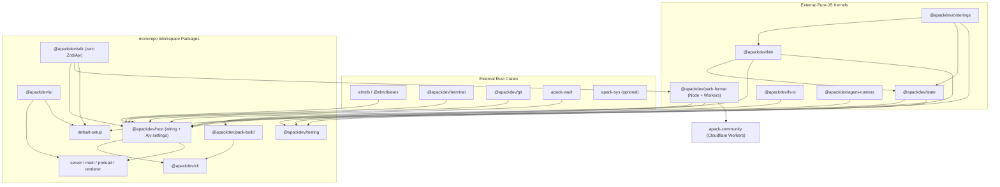

# Platform Modernization Roadmap

*Updated 2026-11-23 · Continuous numbering (`#1`–`#26`), ordered by execution phase.*  
**Size:** `S` (hours) · `M` (days) · `L` (1–2+ weeks)

> [!IMPORTANT]
> **Cutover guard:** Until Phase 3 (`@apackdev/state` + `@apackdev/link` cutover) lands, avoid broad mechanical edits (lint autofixes, annotation passes, `afterEach` scrubs) across the ~132 XState specs and ~27,500 lines of machine definitions so every edit doesn't become a merge conflict on the cutover branch.

---

## Phase 1 — Land & Foundation (now, zero conflict with cutover)

| # | Work Item | Size | Scope |
|---|---|---|---|
| 1 | ~~**Merge PR #632 & PR #633**~~ *(Done — merged on `master`)* — Node 24 / `erasableSyntaxOnly` follow-ups (`#632`) and [singleton-free-test-harness.md](singleton-free-test-harness.md) (`#633`). | S | `monorepo` |
| 2 | **Run full gate on `master`** — `npm run chain` / CI (Linux `test:native`, full `test:integration`, `test:e2e`) to baseline post-#628/#632. | S | `monorepo` |
| 3 | **Split `@apackdev/sdk` along the runtime vs. format/compiler seam** (workspace packages in `monorepo` first; builds on in-flight PRs `#634` & `#635`): • **`@apackdev/sdk`**: zero Zod, zero Ajv, zero compilers — plain TS interfaces + runtime APIs + tiny zero-dep authoring helpers (`entry`, `on`, `ActionMeta`, `PromptMeta`, `FlowDSL`, pure `_settingsJsonProblems`). • **`@apackdev/pack-format`** *(Workers-safe, pure JS — no `node:fs`, no `ajv`)*: Zod manifest & snapshot schemas (`satisfies z.ZodType<...>`), `PACK_LAYOUT`, `semver` host compatibility, `apack.schema.json`. • **`@apackdev/pack-build`** *(or inside `@apackdev/cli`)*: codegen (`generate-entries`), content compilers, settings types, `json-schema-to-typescript`, `mdast-*`, `yaml`, `esbuild`, `typescript`. • Keep `settings-validation.ts` (`ajv`) in `@apackdev/host` (inlined into `@apackdev/cli`), and remove static host re-validation from renderer's [pack-catalog.ts](../../packages/apack-host/src/fe/pack-catalog.ts) — drops 96.6 KiB Zod from the renderer bundle and ~8s / 22.9% of types from `typecheck`. | M | `monorepo` |
| 4 | **Extract root `tsconfig.base.json` (+ `node`/`dom` presets) & drop `baseUrl`** in [packages/main/tsconfig.json](../../packages/main/tsconfig.json) and [packages/preload/tsconfig.json](../../packages/preload/tsconfig.json) — eliminates 15-file drift and preps for TypeScript 7. | S | `monorepo` |
| 5 | *(Optional pre-cutover win)* **Enable Vitest 4 `test.projects` + `isolate: false`** on already-pure, non-XState, non-`bindHost` suites (`apack-cli` unit, `apack-sdk/tests/{utils,build}`, pure `internal-repo-checks` / `apack-host`), verified with `--shuffle`. | S | `monorepo` |

---

## Phase 2 — Cutover Readiness (2–4 days of de-risking before opening cutover branch)

| # | Work Item | Size | Scope |
|---|---|---|---|
| 6 | **Finalize & pin external kernels:** merge `apack-link#25` (`accept` owners) + `review-fixes`, merge `apack-state` CI fix + switch `apack-state`'s `src/schedule.ts` onto `@apackdev/orderings` + bump its `@apackdev/link` pin; add `apack-state`, `apack-link`, and `apack-orderings` to [external-packages.mjs](../../scripts/lib/external-packages.mjs) and `SHARED_INSTANCE_PACKAGES`. | S–M | 4 repos |
| 7 | **Finalize & verify `packages/main` ↔ `packages/server` window-owner lifecycle** — monotonic `windowId`, stateless per-window HMAC `linkCredential` (separate from `apiToken` so Playwright/`apack drive`/`/dev/reload` stay intact), spawn-env revocation watermark (`APACK_WINDOW_WATERMARK`), IPC `window:gone` + exit-on-disconnect invariant, `link.onEnd`-bound subscriptions, and `@apackdev/orderings` every-ordering proof. See [Window-Owner Lifecycle & Deferred Transport Architecture](#window-owner-lifecycle--deferred-transport-architecture-7). | S–M | `monorepo` |
| 8 | **Run a throwaway 1-feature spike** against the released tarballs porting the hardest real slice (**commit surface + one live brain flow touching `runHistory`**) to validate the non-EARS transaction boundary and benchmark TS 5.9 compile time extrapolated to 49 machines. | M | `monorepo` |
| 9 | **Write the feature-by-feature cutover order/size table** and lock the **singleton-free `using`-disposable test harness** contract (`@apackdev/testing` + `@apackdev/sdk/testing` driving `@apackdev/state` + `@apackdev/link` on one `@apackdev/orderings` schedule). | S | `monorepo` |

---

## Phase 3 — The XState + tRPC Cutover ([apack-state.md](apack-state.md))

| # | Work Item | Size | Scope |
|---|---|---|---|
| 10 | **Enable `oxlint-tsgolint` (`--type-aware`) on new transport/kernel code** to catch floating promises and async stream bugs as they're written. | S | `monorepo` |
| 11 | **Build the new singleton-free `using` test harness** (verified with two concurrent `using app = createTestApp(...)` instances in one test + `--shuffle`). | M | `monorepo` |
| 12 | **Execute the cutover:** host bus/shell, `@apackdev/link` transport + window-owner wiring, restated SDK pack contract (`defineSystem`, `#generated/events`, `#generated/fe`, `ask`/`fromAsk`, `useState`, `fromView`), all 49 machines (~27.5k lines) & ~132 specs, pack rules, docs/templates, and remove XState / `@xstate/vue` / tRPC. | L | `monorepo` |

---

## Phase 4 — Post-Cutover Platform & Toolchain Payoffs (`monorepo`)

| # | Work Item | Size | Scope |
|---|---|---|---|
| 13 | **Roll Vitest 4 `isolate: false` across the rewritten runtime/feature suites** — cashes in `#11` on the ~841s import/setup CPU tax (`333s` host + `508s` pack); keep only global-mutating specs in `isolate: true`. | M | `monorepo` |
| 14 | **Enable `oxlint --type-aware` repo-wide + add `oxlint` `jsPlugins` rule enforcing `errorMessage()` at boundaries** (bans raw `instanceof Error ? e.message : ...` that swallows `SuppressedError`s). | S | `monorepo` |
| 15 | **Replace `tsup` with `tsdown` in `packages/server` & unify duplicate `esbuild` (`0.25`/`0.28`) / `vite` (`7`/`8`) trees.** | S–M | `monorepo` |
| 16 | **Make codegen'd pack `ears.ts` (`emitEARS`) erasable** (`export const EARS` + type-only `export namespace EARS`), unlocking `erasableSyntaxOnly: true` for packs and eventual `tsx`-free pack builds. | M | `monorepo` |
| 17 | **Enable selective `isolatedDeclarations: true`** on `@apackdev/sdk` + `@apackdev/host` (unblocked once Zod `z.infer` and tRPC `AppRouter` are gone). | M | `monorepo` |
| 18 | **Evaluate `rolldown-plugin-dts`** to replace `rollup` + `rollup-plugin-dts` in [types-bundler.ts](../../packages/apack-cli/src/build/types-bundler.ts) (verify determinism specs). | M | `monorepo` |
| 19 | **Upgrade to TypeScript 7 (native Go `tsc`)** for 8–12× faster typechecks once TS 7.1 programmatic API / `vue-tsc` / `@microsoft/api-extractor` support lands. | M | `monorepo` |
| 20 | **Sweep minor leftovers** — bump `@tsconfig/node22` in [packages/renderer/tsconfig.node.json](../../packages/renderer/tsconfig.node.json), optionally silence cosmetic esbuild CJS `[empty-import-meta]` warnings, and decide on `@standard-schema/spec` if validator-agnostic pack tool schemas are wanted. | S | `monorepo` |

---

## Phase 5 — Standalone Repo Extractions & Ecosystem Rollout (independent, priority order)

| # | Work Item | Size | Scope |
|---|---|---|---|
| 21 | **Promote `@apackdev/pack-format` to its own repo (`spankyed/apack-pack-format`)** once post-cutover `apack.json` settles, and wire `apack-community` onto it (deletes `scripts/vendor-manifest-schema.ts`). | M | New repo + `monorepo` + `apack-community` |
| 22 | **Roll out Node `>=24.12.0` / `@types/node@^24.12.0` / `using` / `erasableSyntaxOnly` baseline** across sibling repos (`apack-community`, `elmdb`, `apack-state`, `apack-link`, `apack-orderings`, `apack-terminal`, `apack-git`). | M | Sibling repos |
| 23 | **Extract `apack-vault` (Rust, own repo):** OS keystores (Keychain / DPAPI / Secret Service) + `zeroize` memory wiping + encrypted secret envelope. | M–L | New repo + `monorepo` |
| 24 | **Extract `apack-fs-tx` (`@apackdev/fs-tx`, TS, own repo):** crash-safe `private-file`, `replace-dir`, `exclusive-lock`, `process-liveness` with dedicated fault-injection / Windows-retry / Stryker suite. | M | New repo + `monorepo` |
| 25 | **Extract `apack-agent-runners` (`@apackdev/agent-runners`, TS, own repo):** `claude-code` & `codex` subprocess/JSONL adapters decoupled from `default-setup` so external CLI wire-protocol changes ship independently. | M | New repo + `monorepo` |
| 26 | *(Optional)* **Build `apack-sys` (Rust, own repo):** `goblin` ELF/Mach-O/PE binary inspection (dropping PowerShell helpers), `rayon`/`sha2` parallel tree hashing, native OS process-tree queries (dropping `ps` forks), and optional `notify` watcher. | L | New repo + `monorepo` |

---

## Window-Owner Lifecycle & Deferred Transport Architecture (`#7`)

A link outlives its WebSocket, so socket close no longer tells `packages/server` that a window is gone. Without explicit ownership teardown, the backend retains a session buffer for every window that ever closed. `apack-link#25` provides the link-side primitive (`accept<Owner>()` with `take(transport, owner)` and `gone(owner)`); the host-side design below settles the `packages/main` ↔ `packages/server` contract and its interaction with deferred transport/view work.

### Five-part ownership protocol

1. **Monotonic window IDs in `main`:** `main` assigns `1, 2, 3, …` and never reuses an ID. A window reload keeps the same ID.
2. **Stateless per-window admission:** `main` derives a credential `w.<id>.<hmac>` from `(windowId, runToken)` and passes it to the preload. On WebSocket upgrade, `server` verifies the HMAC statelessly and hands the socket to `accept()` as `owner = window:<id>` (never crossing the wire). One window cannot forge another's identity.
3. **Teardown over existing IPC:** on a window's `closed` event, `main` sends `{ type: 'window:gone', id }` over the existing `ApiServer` IPC channel ([ApiServer.ts](../../packages/main/src/modules/api-server/ApiServer.ts)). `server` calls `gone('window:' + id)`, ending that owner's session and shutting its open connections.
4. **Bounded monotonic revocation watermark:** `server` remembers closed IDs as `{ minLiveId, revokedAboveMin }` — rejecting every ID `< minLiveId` plus the small set of closed IDs above it — so a closed window can never be re-admitted.
5. **Local tools own only their socket:** the CLI and test clients authenticate with the master `apiToken`, receive a throwaway `owner = tool:<connId>`, and trigger `gone(owner)` when their socket closes.

### Four settled host constraints (verified in codebase)

1. **Zero-gap restart watermark:** do **not** send the initial watermark over IPC after `listening` (which would leave a race window where a late connection from a closed window passes HMAC and is admitted). Pass `{ minLiveId, revokedAboveMin }` in the **spawn environment** (`APACK_WINDOW_WATERMARK`, captured and deleted from `process.env` at boot alongside `captureApiToken()`), and attach `process.on('message')` before `server.listen()`.
2. **Backend exit on IPC disconnect:** `server` must exit when its IPC channel to `main` disconnects so an orphaned backend cannot leak sessions indefinitely. This hook already exists in [websocket.ts](../../packages/server/src/transport/websocket.ts) over [ApiServer.ts](../../packages/main/src/modules/api-server/ApiServer.ts)'s `stdio: ['ignore', 'pipe', 'pipe', 'ipc']`; promote it to an explicit, regression-tested invariant.
3. **One link per window:** confirmed for the app renderer today ([transport/index.ts](../../packages/renderer/src/transport/index.ts)). If multi-link windows (popouts, embedded webviews) are added later, extend the HMAC payload additively to `window:<id>:<channel>` without changing the link protocol.
4. **Separate `linkCredential` from `apiToken` on `window.electronAPI`:** the renderer uses `apiToken` only for its single WebSocket (`pack://` is handled in `main`), **but test tooling reads `window.electronAPI.apiToken` from the live window via CDP**:
   - Playwright's fixture ([connection.ts](../../packages/apack-testing/src/connection.ts)) and `apack drive` ([engine/index.ts](../../packages/apack-testing/src/engine/index.ts)) read `window.electronAPI.apiToken` to open a **second** WebSocket to the backend.
   - Five E2E specs (`tests/e2e/app-integration/{api-access,dev-reload,surface-sends}.spec.ts` and `tests/packs/external-pack/tests/e2e/{dev-reload,default-pack-fork}.spec.ts`) read `window.electronAPI.apiToken` to call HTTP `POST /dev/reload`.
   - Replacing `window.electronAPI.apiToken` directly with `cred(windowId)` would make Playwright/`apack drive` authenticate as `window:1` (immediately killing the real window's session in `accept()`) and 403 `/dev/reload`. Expose a dedicated `linkCredential` (`w.<id>.<hmac>`) exclusively for the renderer's own link, and keep `apiToken` temporarily for tool WebSockets (`tool:<connId>`) and HTTP `/dev/*` until test tooling stops scraping credentials from the window (tracked by [goal-pack-security-isolation.md](../goals/goal-pack-security-isolation.md)).

### Subscription lifetime invariant (`link.onEnd` vs. `gone(owner)`)

Bind all per-session state — JS views today and future engine-held incremental views later — to **`link.onEnd`**, never directly to `gone(owner)`:

- On **window reload**, `owner` (`window:<id>`) does **not** change, so `gone(owner)` never fires. Instead, `accept()` sees a fresh session ID for the same owner, synchronously calls `had.link.close('ended')` (firing `had.link.onEnd`), and then invokes `onLink(newLink, owner)`.
- On **window close**, `gone(owner)` calls `sessions.get(owner)?.link.close('ended')` (also firing `link.onEnd`) and closes any pre-hello sockets.

`link.onEnd` is therefore the single unified teardown hook for both reload and close; `gone(owner)` is the liveness guarantee that `link.onEnd` will eventually fire for a closed window that stops reconnecting.

### Verification bar (every-ordering proof)

Verify the host owner-gate and spawn-watermark logic with a deterministic `@apackdev/orderings` state-machine test exhausting interleavings of `open`, `reload`, `close`, `window:gone` IPC delivery, late pre- and post-hello `upgrade`, and `backend restart` (with spawn-env watermark), asserting:

- `activeSessions <= liveWindows` after quiescence,
- no closed window is ever admitted after `window:gone` or across a backend restart,
- a reload never leaves two live sessions or leaked subscriptions for the same `window:<id>`.

### Compatibility with deferred transport & engine-views plans

Ownership interacts cleanly with both [what-a-window-reaches-its-backend-over.md](deferred/what-a-window-reaches-its-backend-over.md) and `apack-link`'s deferred `docs/deferred/views-from-the-engine.md` (elmdb incremental view diffs written as bytes without server JS in between) — **with one architectural fork to decide before starting either deferred doc**:

- **What ownership already unlocks:** keeping `owner` as an opaque local token (`window:<id>`) decoupled from the wire protocol makes admission cheap to relocate, and `link.onEnd` + `gone(owner)` gives future engine-held views their exact subscription teardown lifecycle.
- **The transport fork (`MessagePort` vs. local socket):** [what-a-window-reaches-its-backend-over.md](deferred/what-a-window-reaches-its-backend-over.md) proposes Electron `MessagePort` (`utilityProcess`) for windows — which eliminates HMAC credentials and loopback ports altogether because a transferred port is unforgeable owner identity. However, `views-from-the-engine.md` requires *"something that writes a link's bytes without JavaScript in between. That is the engine, or a process beside it, holding the socket."* Rust (`elmdb`) **cannot** write directly to a Chromium/V8 `MessagePort` without crossing Node/JS and structured clone, whereas an OS socket file descriptor (Unix domain socket / named pipe / loopback WebSocket) can be owned directly by Rust. Before committing windows to `MessagePort`, decide explicitly whether zero-JS engine views stay on the table — if so, windows belong on a local socket rather than `MessagePort`, and only the admission check moves beside whoever holds the socket.

---

## Target Package & Repository Boundary Map

> [!NOTE]
> **Extraction principle:** Extract a primitive to its own repo when it has a different toolchain (Rust), a sharp domain-free invariant deserving its own proof/mutation/fault-injection suite, an independent release cadence, or multiple top-level app consumers. Keep lockstep-evolving platform packages as workspace packages in `monorepo`.

| Package | Repo Home | Runtime | Single Invariant Owned |
|---|---|---|---|
| `@apackdev/sdk` | `monorepo` | Node + Browser | Pack runtime APIs, plain TS contracts, zero-dep authoring helpers (`entry`/`on`) |
| `@apackdev/pack-format` | `monorepo` → own repo (Phase 5) | Pure JS (Node + Workers) | Zod manifest & snapshot schemas, `PACK_LAYOUT`, `semver` compat, `apack.schema.json` (no `ajv`, no `node:fs`) |
| `@apackdev/pack-build` | `monorepo` | Node | Deterministic pack compiler kernel (codegen, content compilers, sealed candidates) |
| `@apackdev/cli` | `monorepo` | Node | User-facing CLI shell (`init`, `dev`, `build`, `db`, `doctor`, `drive`, `release`) |
| `@apackdev/ui` | `monorepo` | Browser (Vue) | Pack & app UI components and composables |
| `@apackdev/testing` | `monorepo` | Node (test) | Singleton-free, `using`-disposable test harness |
| `@apackdev/host` *(private)* | `monorepo` | Node + FE host | Thin app composition + `ajv` settings compilation (inlined into `cli`) |
| `@apackdev/state`, `@apackdev/link`, `@apackdev/orderings` | Own repos (TS) | Pure JS | State kernel, ordered stream, deterministic schedule runner |
| `elmdb`, `@apackdev/terminal`, `@apackdev/git` | Own repos (Rust) | Native | EARS/LMDB store, PTY terminal broker, git engine |
| `apack-vault` | Own repo (Rust) | Native | OS keystores + `zeroize` + encrypted secret envelope |
| `apack-fs-tx` | Own repo (TS) | Node | Transactional local fs (`private-file`, `replace-dir`) & PID locks |
| `apack-agent-runners` | Own repo (TS) | Node | External coding-agent CLI adapters (`claude-code`, `codex`) |
| `apack-sys` *(optional)* | Own repo (Rust) | Native | Binary (`goblin`) inspection, parallel hashing, OS process-tree queries |

